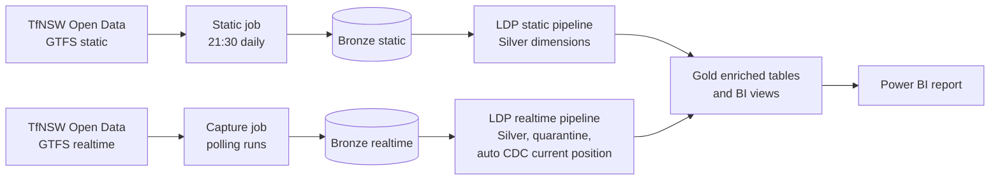
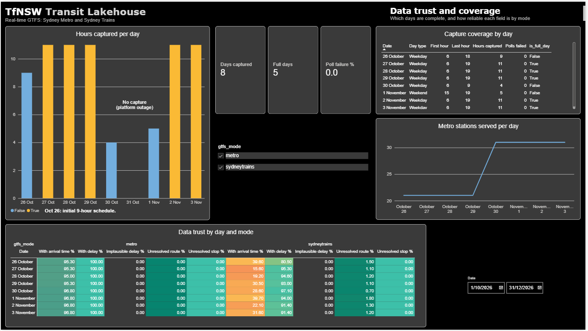
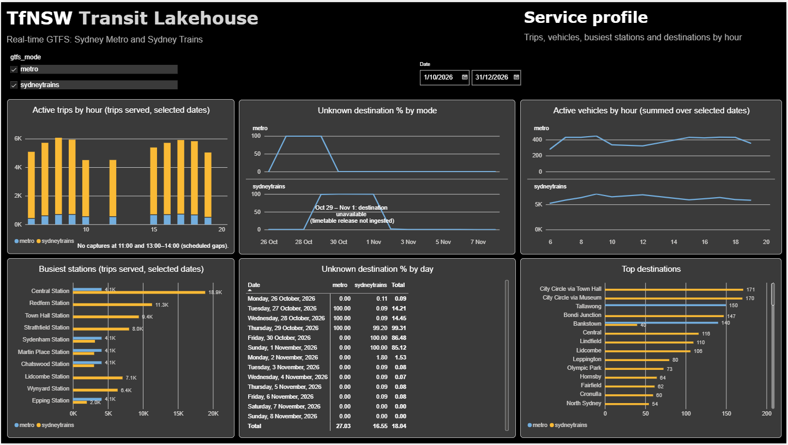
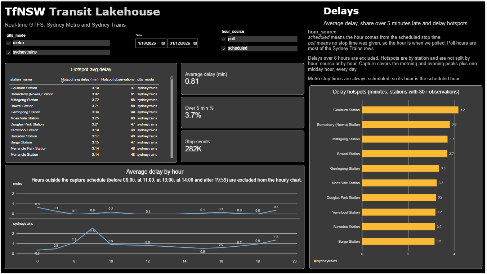
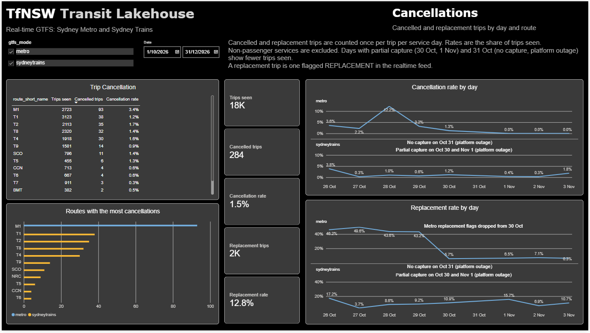
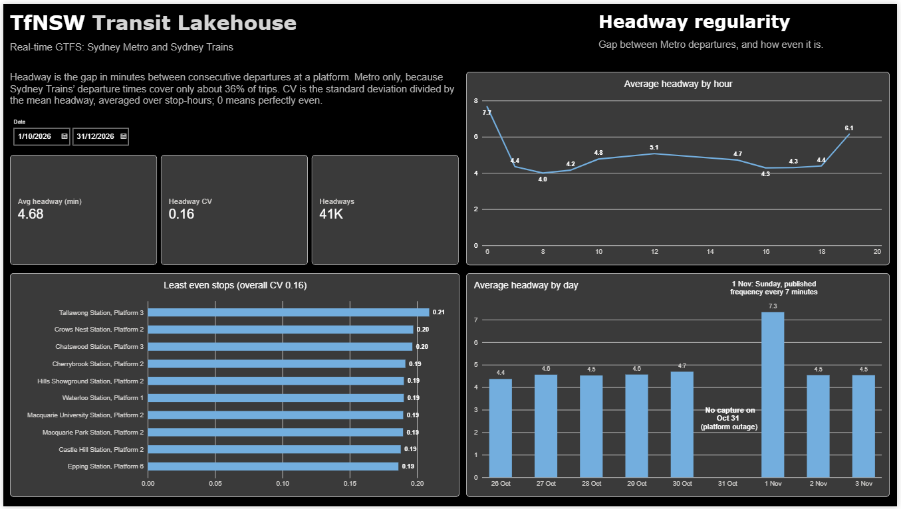
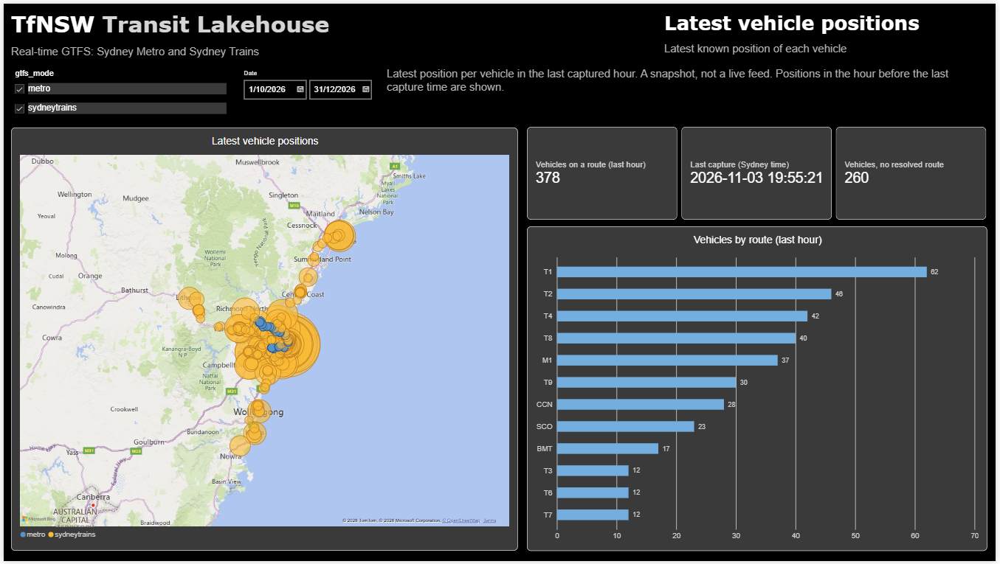

# TfNSW Transit Lakehouse

A Databricks lakehouse for Sydney Trains and Sydney Metro GTFS data (static timetables and realtime vehicle positions and trip updates) from Transport for NSW Open Data. It follows a medallion design on Unity Catalog, uses Lakeflow Declarative Pipelines (LDP), is deployed with Databricks Asset Bundles, provisioned with Terraform, and promoted through gated CI/CD.

> Contributions are not open at this time.

## What it does

- **Static GTFS (daily refresh):** a job downloads the GTFS static feeds (Sydney Trains from the v1 endpoint, Metro from v2) into a landing volume, then an LDP pipeline builds Bronze and Silver for routes, trips, stops and the other static entities. It is scheduled at 21:30 Sydney time, ahead of the nightly processing run, because Gold resolves route, stop and destination names when it processes a row.
- **Realtime capture:** a scheduled job polls the GTFS-realtime feeds for both modes and appends the raw rows to Bronze. One 55-minute run (a poll every 30 seconds) starts at each of the hours 06–10, 12 and 15–19 Sydney time, 11 hours a day. Each run writes one row per feed to `bronze_streaming_run_log` (polls attempted, polls failed, rows written) and fails the job if a feed returns no rows or too many polls fail.
- **Realtime processing:** a nightly job (22:00) runs the realtime LDP pipeline, which builds Silver (with data-quality expectations and quarantine tables) and Gold, then publishes the BI views.
- **Current position:** the latest position per vehicle uses LDP auto CDC (SCD Type 1), keyed on vehicle and sequenced by position timestamp, so a late-arriving stale row can never overwrite a newer one.
- **Gold and BI:** enriched vehicle-position and trip-delay tables, plus BI views (latest observation per trip and stop, service profile, route delay summary, delay hotspots, cancellations, busiest stations, destinations, Metro headway regularity, current vehicle positions, capture coverage, data trust and network regime) feed a Power BI report.

## Architecture

## Jobs and schedules

| Job | Schedule (Australia/Sydney) | What it does |
|---|---|---|
| `tfnsw_static_refresh` | Daily 21:30 | Provisions the environment, downloads the static feeds, runs the static pipeline |
| `tfnsw_realtime_capture` | Hours 06–10, 12, 15–19 | Polls the realtime feeds for 55 minutes, appends to Bronze, writes the run log |
| `tfnsw_realtime_process` | Daily 22:00 | Runs the realtime pipeline (Silver, Gold), then publishes the BI views |

Every schedule defaults to paused in every target (`capture_schedule_status`, `process_schedule_status`, `static_schedule_status`). A target unpauses the ones it needs. The capture job takes `poll_duration_seconds` (default 3300) and `poll_interval_seconds` (default 30) as parameters, so a short run is a parameter override.

## Repository layout

| Path | Contents |
|---|---|
| `databricks.yml`, `resources/` | Asset Bundle config: static and realtime jobs and pipelines, and the test-suite job |
| `ldp_pipelines/` | LDP pipeline code for static and realtime |
| `utils/` | Pure transform functions used by the pipelines and unit tests |
| `commonsetup/` | One-time environment provisioning and shared config notebooks |
| `download/` | GTFS static download notebook |
| `notebooks/`, `ingestion/` | Notebooks the jobs still run: the streaming Bronze ingestion and the BI views publish step |
| `legacy/` | Retired notebook-based Silver and Gold, the old upsert functions and their tests, kept as reference (see Evolution) |
| `tests/` | `unit`, `integration` and `e2e` tiers, run on Databricks by `runtests.ipynb` |
| `terraform/` | Azure infrastructure |
| `.github/` | Workflows for each gate, and exported branch rulesets |
| `powerbi/` | An earlier dashboard (`.pbix`, Sydney Trains only) and a PDF snapshot |
| `docs/` | Sample variable overrides and Power BI report snapshots |

## Environments and promotion gates

Work moves `develop` → `staging` → `main`, and each hop is gated by a different test tier:

| Event | Gate | What runs |
|---|---|---|
| Push to `develop` | Unit tests | Pure transform tests |
| Pull request into `staging` | Integration tests | CDC "latest position wins" invariant, run against the real pipeline |
| Pull request into `main` | End-to-end tests | The static job, then the capture job (a 15-minute poll window), then the process job, then checks that the Gold tables and BI views are queryable, plus data-quality checks |

Branch rulesets (exported in `.github/rulesets/`) require pull requests, merge commits only, and the integration and e2e checks to pass, with no bypass actors. The bundle has `dev`, `staging` and `prod` targets, each with its own Unity Catalog catalog. GitHub environments hold the per-stage secrets.

## Infrastructure

Terraform provisions the resource group, an ADLS Gen2 storage account, a Databricks access connector, a Premium (serverless) Databricks workspace, a Key Vault (RBAC authorisation, purge protection), Log Analytics with diagnostic settings, and a Network Security Perimeter. The perimeter enforces access to Key Vault; storage association is currently in transition (learning) mode.

## Getting started

1. Apply the Terraform in `terraform/` (copy your values into a git-ignored `terraform.tfvars`).
2. Copy `docs/variable-overrides.json` to `.databricks/bundle/<target>/variable-overrides.json` and fill in your workspace host, storage account name and notification email.
3. Run `commonsetup/00 provision environment` once per environment. It creates the catalog, schema and the landing and checkpoint volumes. The static job also runs it as its first task.
4. `databricks bundle deploy -t dev`
5. Run the static job, then the capture job, then the process job. For a short capture, pass `poll_duration_seconds` (for example 900) when you start it.

New environments need step 3 first: the pipelines and tests assume the schema and volumes exist.

## Testing

- **Unit:** the transform functions in `utils/`, with no cluster dependency beyond Spark.
- **Integration:** seeds Bronze with a newer and a stale row for a uniquely named test vehicle, runs one realtime LDP pipeline update through the Databricks SDK, then checks that the update completed, both rows reached Silver, the current table holds exactly one row for the vehicle, and that row is the newer position. The tests never delete anything. The tier starts by running the static, capture and process jobs, so it works on a fresh environment.
- **End-to-end:** runs the static job, the capture job (a 15-minute poll window) and the process job, then checks that the tables are populated, Bronze equals Silver plus quarantine for vehicle positions and trip updates, the current-position table has one row per vehicle, Gold row counts match Silver for vehicle positions and trip updates, the static dimension keys are unique, and no Gold trip delay has an unresolved stop name.

## Design decisions

- **Realtime Bronze is append-only, enforced.** The ingestion notebook sets `delta.appendOnly` on both realtime Bronze tables, so deletes and updates are rejected. A corrected row is just another row, and Silver deduplicates.
- **Realtime Bronze rescues schema changes instead of evolving.** Columns that are new, or whose type differs from the existing table, go into a `_rescued_data` JSON column. A feed change never breaks the write or silently changes the table. The trade-off is that an environment holding an older Bronze table needs it recreated to pick up new fields (see Engineering notes).
- **Static Bronze uses Auto Loader with a declared schema per entity.** A registry drives one streaming table for each of the seven static entities. Auto Loader reads the CSV columns as text, and each is converted to its declared type with `try_cast`, so a malformed value becomes null instead of failing the load. Unexpected columns go to a rescued-data column (schema evolution mode `rescue`) instead of being lost.
- **Streaming reads fail loudly on source changes.** Silver and Gold read their sources with plain streaming reads, so a delete or update in a source fails the stream instead of being skipped silently. The trade-off is that a legitimate delete, such as an erasure request, needs a controlled full refresh downstream.
- **Bad rows are quarantined, not dropped.** Named expectations route rows (for example, a vehicle position with no coordinates) to `_quarantine` tables with the original payload intact.
- **Current position uses auto CDC.** The latest position per vehicle is decided by position timestamp, not arrival order, and the integration tier proves it.
- **Gold joins are LEFT joins.** An unscheduled trip often has no static record; that is normal GTFS, so it still produces a row with nulls.
- **Gold names are resolved at processing time.** Gold is a stream-static join: each row picks up the route, stop and headsign that exist in the static tables when it is processed. That is why the static refresh runs before the nightly process, and why a full refresh of the Gold tables re-resolves history against the current timetable.
- **Liquid clustering on the streaming tables.** Silver and Gold streaming tables cluster on `gtfs_mode` and `poll_timestamp`, which are the columns the BI queries filter on. The keys can change later without rewriting the table.
- **BI views, not tables.** The views keep the latest observation per mode, service date, trip and stop, exclude non-passenger movements, and flag delays beyond six hours as implausible so the delay summaries leave them out. The service date comes from the feed's `start_date`, falling back to the poll time in Sydney.
- **Metro and Sydney Trains are handled differently where the data differs.** Metro static uses the v2 feed, because the v1 IDs do not match the v2 realtime feed. Headway regularity is computed for Metro only: Sydney Trains carries scheduled times on a minority of stop updates, which would bias it. A network-regime view marks days when the number of Metro stations served changes.
- **One table per entity, with a `gtfs_mode` column.** Adding buses later is a filter, not a UNION. Sydney Trains and Metro are active; buses are not.
- **Each run writes once.** The notebook collects polls in memory for the whole window and appends once at the end, which avoids a small Delta write every 30 seconds. A crash mid-run loses that run's polls, and the failed run and its alert make the loss visible.

## Engineering notes

Things that went wrong on the way to a green `main`, and what they changed:

1. **Stale bundle state produced a destructive plan on staging.** A pipeline that no longer existed in the bundle was still in deployment state. I approved the plan locally after checking that only that pipeline was deleted, and CI never uses auto-approve.
2. **The integration tier depended on tables built elsewhere.** The CDC test needed static and realtime tables that only the pipelines create, so it failed on a clean environment. Fix: the integration tier now runs the static, capture and process jobs first (a deliberate copy of the e2e tests).
3. **A test fixture deleted rows from streaming sources.** The integration test cleaned up its synthetic vehicle by deleting rows from Bronze and Silver, which are streaming sources, and a Delta stream fails when its source has a delete commit (`DELTA_SOURCE_IGNORE_DELETE`). `DESCRIBE HISTORY` showed the `DELETE` on the Bronze table. The first run after a rebuild passed, because no delete commit existed yet; every later run failed. I first worked around it with `skipChangeCommits`, then removed that, since it would hide a real violation of an append-only Bronze. The tests now seed a uniquely named vehicle and never delete.
4. **Unknown destinations that a rerun could not fix.** The dashboard showed 99–100% Unknown destination for Sydney Trains on Oct 29 – Nov 1. Route and stop resolution were fine (under 2% unresolved), so the join was not broken. The two timetable releases I had ingested shared no trip IDs (the Silver trip count was exactly the sum of both), and trip IDs change with each release. Gold resolves the headsign at processing time, so rows processed before their release was loaded kept a null headsign. A per-day check split the nulls into "trip not in the static table" and "trip found, headsign blank". After a full refresh of the Gold tables, Nov 2 fell to 1.8% Unknown and Nov 3 to 0.09%. Oct 29 – Nov 1 did not change, because those releases were never ingested. The static refresh is now scheduled daily at 21:30, ahead of the 22:00 process run.
5. **A stale Bronze table failed an otherwise clean deploy.** The Bronze trip-update tables in dev, staging and prod predated the current schema. Because new and retyped columns are rescued, the new fields landed in `_rescued_data` and Silver failed with an unresolved column. The e2e tier caught it. The fix was to recreate the Bronze trip-update table and run a full refresh of the downstream pipeline.

## Trade-offs and known gaps

**Solo-build trade-offs**
- One workspace with separate catalogs per stage, not separate workspaces.
- A personal access token for CI, not a service principal with OIDC, and no required reviewers between stages.
- A Network Security Perimeter instead of VNet injection or Private Link.
- Realtime Bronze is a polling notebook, with LDP for Silver and Gold. An LDP-native Bronze variant is kept in `ldp_pipelines/realtime/bronze.py`.
- The workspace host is committed in `databricks.yml` on purpose, so a misconfigured CI variable cannot send a deploy elsewhere. It is an identifier, not a credential.
- Job tasks run with `max_retries: 0`: a deterministic failure just repeats on retry, so a failing run should fail fast and alert.

**Known gaps**
- Buses are not active; the schema is mode-aware.
- Environment provisioning is a notebook, not Terraform.
- The storage account's Network Security Perimeter association is in learning mode, not Enforced.
- Sydney Trains static comes from the v1 endpoint and Metro from v2.
- Static Bronze tables have no `delta.appendOnly` property, and write access to Bronze is not restricted to the ingestion identity.
- Static Bronze converts values with `try_cast`, so a malformed value becomes null and the original text is not kept.
- Each realtime run writes once at the end, so a crash loses that run's polls.
- Integration tests share the staging catalog, and their synthetic vehicles (the `TEST_V_CDC_` prefix) stay in staging Bronze.

**Data limitations** (observed Oct 26 – Nov 3, 2026)
- **Coverage is windowed.** Capture runs 11 hours a day, so a full day is 11 captured hours. No capture on Oct 31 (platform outage); Oct 30 and Nov 1 are partial days.
- **Destination depends on the timetable release.** Sydney Trains: Unknown on Oct 29 – Nov 1 (99–100%), 1.8% on Nov 2, 0.09% on Nov 3, and about 0.1% before Oct 29. Metro: Unknown on Oct 27–29 (100%), resolved on Oct 26 and from Oct 30.
- **Route and stop resolution is high.** Sydney Trains unresolved route is 0.7–1.8% a day and unresolved stop 0.0%. Metro is 0.0% for both.
- **Sydney Trains scheduled times are sparse.** Arrival times are present on about 16–40% of stop updates, against about 95–97% for Metro, so headway regularity is Metro-only.
- **The Metro network changed.** Stations served rose from 21 to 31 on Oct 30; the network-regime view marks the change so comparisons across it are explicit.
- **Delay hours are the scheduled hour.** Where a stop has a scheduled time, the hour comes from it, not from when it was polled, so the delay summary includes stops scheduled outside the capture hours. The hourly chart excludes hours before 06:00, at 11:00, 13:00–14:00 and after 19:59. Hotspots are by station and not split by hour.
- **Metro delay averages are rounded to 0.1 minute** in the route delay summary view.
- **Sydney Trains mode includes intercity and regional services**, which is why the largest delay hotspots are regional stations.
- **Metro replacement flags changed on Oct 30.** Trips flagged REPLACEMENT in the feed were about 43–50% of Metro trips on Oct 26–29 and about 6–7% from Oct 30. The cause has not been verified.
- **Some vehicles have no resolved route.** In the last captured hour, 260 of 638 vehicles had no resolved route and are excluded from the route chart.

## Evolution

The original notebook-based Silver and Gold, the batch Bronze notebooks and their MERGE upserts were replaced by LDP pipelines and moved to legacy/. Two notebooks remain live: the streaming Bronze ingestion and the BI views publish step.

## Dashboard

A Power BI report (Import mode) built on the Gold BI views. The snapshots show data from Oct 26 to Nov 3, 2026. It has six pages:

- **Data trust and coverage:** hours captured per day, whether each day is a full day, poll failure rate, field reliability by mode and day, and Metro stations served per day.

- **Service profile:** active trips and vehicles by hour, busiest stations, top destinations, and the Unknown destination rate by mode and day.

- **Delays:** average delay by hour (capture hours only), the share of stop events more than 5 minutes late, and delay hotspots by station.

- **Cancellations:** cancelled and replacement trips by day and route.

- **Headway regularity (Metro only):** the gap between consecutive departures at a platform, by hour, by day and by stop.

- **Latest vehicle positions:** the latest known position of each vehicle in the last captured hour.

The report file is not published, because it embeds the workspace connection. `powerbi/` holds an earlier version of the dashboard (Sydney Trains only), which can be opened in Power BI Desktop without a Databricks connection, and its PDF snapshot.

## Data and attribution

This project uses data from [Transport for NSW Open Data Hub](https://opendata.transport.nsw.gov.au/), licensed under the [Creative Commons Attribution 4.0 International licence (CC BY 4.0)](https://creativecommons.org/licenses/by/4.0/), under the Hub's terms.

Datasets used (Sydney Trains and Metro feeds only; the datasets also cover other modes that this project does not use):

- [Public Transport - Timetables - For Realtime](https://opendata.transport.nsw.gov.au/data/dataset/b4b3601a-93f8-4ab8-8482-f73029a59f53) (static GTFS)
- [Public Transport - Realtime Vehicle Positions API v2](https://opendata.transport.nsw.gov.au/data/dataset/f3da2c60-6cb9-4712-a8e7-403f5cdbe5f3) (GTFS-realtime vehicle positions)
- [Public Transport - Realtime Trip Update API v2](https://opendata.transport.nsw.gov.au/data/dataset/868860ea-feb0-4602-adde-f6b4ba48d738) (GTFS-realtime trip updates)

The data has been transformed in this project (ingested into Bronze, cleaned and conformed in Silver, and enriched in Gold). This is a personal learning project. It is not affiliated with, endorsed by, or sponsored by Transport for NSW or any other transport agency.
